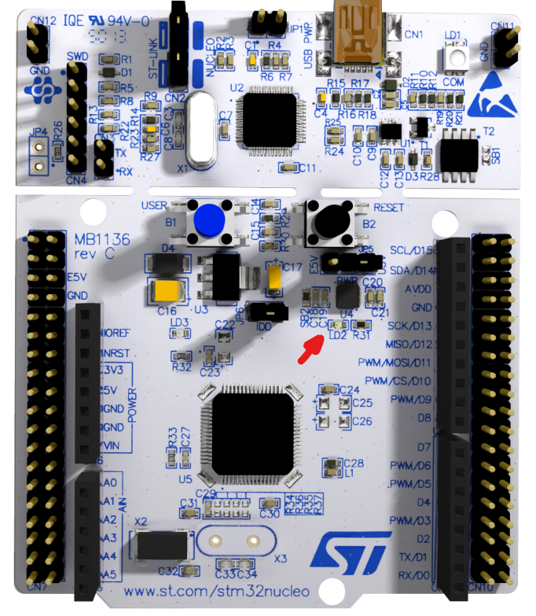

-orange)


# GPIO output (Turn ON user led / Hello world)
## 🎯 Description
First bare-metal firmware project. It directly initializes the hardware registers in C (without HAL or CMSIS libraries) to enable the clock and turn ON the user LED (**LD2**, physically mapped to pin **PA5**, as specified in page 24 of the datasheet).
<br>

## 📌 Hardware pinout
| Component | Pin | Configuration |
| :--- | :--- | :--- |
| User LED (LD2) | PA5 | Output Push-pull |
<br>

<p align="center">
  <br>
  <small><i>Physical location of user LED (LD2) indicated by the red arrow.</i></small>
</p>
<br>

## 📺 Hardware demonstration
> 👉 [Watch the hardware demonstration video on YouTube](Iwillputthelinkhere)
<br>

## ⚙️ Core Logic (Register Sequence)
The firmware executes the following low-level sequence:
1. **Clock Enable:** Sets bit 0 in `RCC_AHB1ENR` to active the AHB1 bus clock for GPIOA.
2. **Mode configuration:** Clears bits 11:10 and sets pin PA5 as general-purpose output in `GPIOA_MODER`.
3. **Output State:** Sets bit 5 in `GPIOA_ODR` to drive the pin high (3.3V) and turn on LD2.


```c
#include <stdint.h>

#define RCC_AHB1ENR ((volatile uint32_t*)0x40023830)  //Clock for peripherals in bus AHB1 (like GPIOA)
#define GPIOA_MODER ((volatile uint32_t*)0x40020000) //MODER = Mode register
#define GPIOA_ODR ((volatile uint32_t*)0x40020014) //ODR = Output data register

int main(){
	*RCC_AHB1ENR |= (1 << 0); //Enable GPIOA clock

	*GPIOA_MODER &= ~(3 << (5*2)); //Clear mode bits for PA5
	*GPIOA_MODER |= (1 << 10); //Set PA5 as output
	*GPIOA_ODR |= (1 << 5); //Set PA5 HIGH (Turn ON LD2)

	while (1){ 
        //Infinite loop
	}

	return 0;
}
```